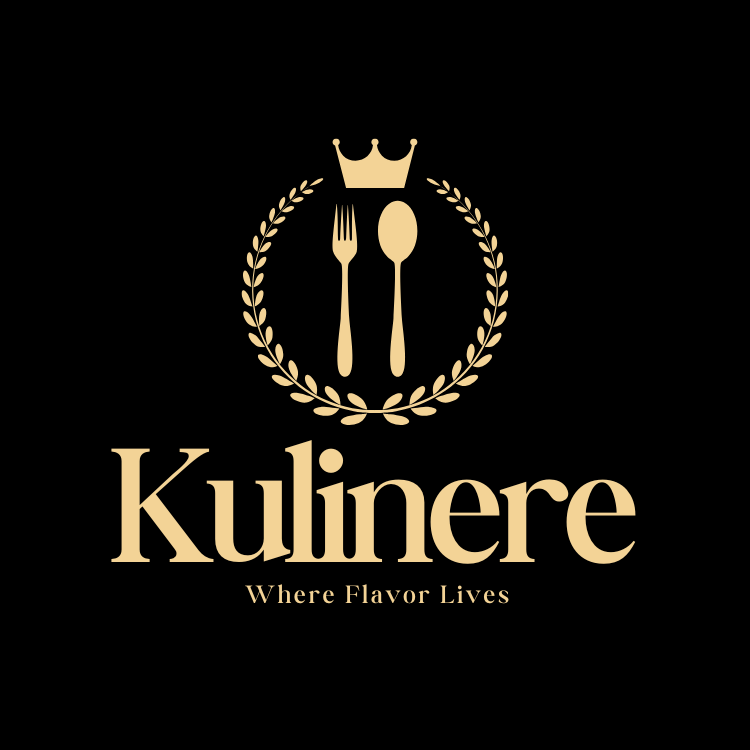

# Kulinere Design System

**App Name:** Kulinere  
**Tagline:** Where Flavor Lives  
**Version:** 1.0  
**Last Updated:** January 2026

---

## Related Documents

| Document | Description |
|----------|-------------|
| [product_requirement.MD](./product_requirement.MD) | Spesifikasi fitur dan API |
| [restaurant_app_implementation_guide.MD](./restaurant_app_implementation_guide.MD) | Arsitektur dan code patterns |

---

## Brand Identity

### Logo


### Brand Personality
- **Premium:** Kesan mewah dan berkualitas
- **Warm:** Hangat dan mengundang
- **Trustworthy:** Dapat diandalkan untuk rekomendasi restoran

---

## Color Palette

### Primary Brand Color

| Name | Hex | Preview | Usage |
|------|-----|---------|-------|
| **Gold** | `#f3d396` | 🟨 | Accent, icons, rating stars, highlights |
| **Gold Dark** | `#C9A86C` | 🟫 | Buttons di light mode (text gelap di atasnya) |

### Light Mode

| Role | Hex | Usage |
|------|-----|-------|
| Background | `#FFFFFF` | Screen background |
| Surface | `#FDF8F0` | Cards, dialogs (warm cream) |
| Primary | `#C9A86C` | Buttons, active elements |
| On Primary | `#1F1F1F` | Text di atas primary button |
| Accent | `#f3d396` | Icons, borders, rating stars |
| Text Primary | `#1F1F1F` | Headings, body text |
| Text Secondary | `#5C5C5C` | Subtitles, captions |
| Divider | `#E0E0E0` | Lines, borders |

### Dark Mode

| Role | Hex | Usage |
|------|-----|-------|
| Background | `#121212` | Screen background |
| Surface | `#1E1A14` | Cards, dialogs (warm dark) |
| Primary | `#f3d396` | Buttons, active elements |
| On Primary | `#1F1F1F` | Text di atas primary button |
| Accent | `#f3d396` | Icons, borders, rating stars |
| Text Primary | `#F5F5F5` | Headings, body text |
| Text Secondary | `#A0A0A0` | Subtitles, captions |
| Divider | `#2C2C2C` | Lines, borders |

### Semantic Colors

| Role | Hex | Usage |
|------|-----|-------|
| Success | `#4CAF50` | Positive feedback, success states |
| Error | `#E53935` | Errors, destructive actions |
| Warning | `#FB8C00` | Warnings, caution states |
| Info | `#2196F3` | Informational messages |

---

## Typography

### Font Pairing

| Role | Font | Weight | Usage |
|------|------|--------|-------|
| **Display/Headings** | Playfair Display | 600-700 | App title, section headers |
| **Body/UI** | Inter | 400-600 | Body text, buttons, labels |

### Type Scale

| Style | Font | Size | Weight | Line Height |
|-------|------|------|--------|-------------|
| Display Large | Playfair Display | 32sp | 700 | 1.25 |
| Display Medium | Playfair Display | 28sp | 600 | 1.29 |
| Headline Large | Playfair Display | 24sp | 600 | 1.33 |
| Headline Medium | Inter | 20sp | 600 | 1.4 |
| Title Large | Inter | 18sp | 600 | 1.44 |
| Title Medium | Inter | 16sp | 500 | 1.5 |
| Body Large | Inter | 16sp | 400 | 1.5 |
| Body Medium | Inter | 14sp | 400 | 1.43 |
| Label Large | Inter | 14sp | 500 | 1.43 |
| Label Medium | Inter | 12sp | 500 | 1.33 |

---

## Spacing System

### Base Unit: 4dp

| Token | Value | Usage |
|-------|-------|-------|
| xs | 4dp | Minimal spacing |
| sm | 8dp | Between related elements |
| md | 16dp | Standard padding, margins |
| lg | 24dp | Section spacing |
| xl | 32dp | Large sections |
| xxl | 48dp | Page margins on tablets |

### Common Patterns

| Context | Value |
|---------|-------|
| Screen padding | 16dp |
| Card padding | 16dp |
| Between list items | 8dp |
| Icon to text | 8dp |
| Section gap | 24dp |

---

## Component Guidelines

### Restaurant Card
- Background: Surface color
- Border radius: 12dp
- Padding: 12dp
- Image: 100x80dp, border radius 8dp
- Shadow: Subtle (elevation 2)

### Buttons
- Primary: Gold Dark (#C9A86C) background, dark text
- Border radius: 8dp
- Padding: 16dp horizontal, 12dp vertical
- Min touch target: 48x48dp

### Rating Stars
- Filled: Gold (#f3d396)
- Empty: Divider color
- Size: 16dp

### App Bar
- Background: Transparent atau Surface
- Title: Headline Medium
- Icons: Text Primary color

---

## Responsive Design & Overflow Prevention

### Prinsip Utama

| Prinsip | Implementasi |
|---------|--------------|
| **Flexible Width** | Gunakan `Expanded` atau `Flexible` untuk konten yang bisa panjang |
| **Text Overflow** | Selalu set `maxLines` dan `overflow: TextOverflow.ellipsis` |
| **Scrollable Content** | Wrap konten panjang dengan `SingleChildScrollView` |
| **Min Touch Target** | Minimum 48x48dp untuk semua interactive elements |

### Pattern: Restaurant Card (Anti-Overflow)

```dart
Card(
  child: Padding(
    padding: const EdgeInsets.all(12),
    child: Row(
      children: [
        // Image dengan ukuran fixed
        ClipRRect(
          borderRadius: BorderRadius.circular(8),
          child: CachedNetworkImage(
            imageUrl: restaurant.imageUrl,
            width: 100,
            height: 80,
            fit: BoxFit.cover,
          ),
        ),
        const SizedBox(width: 12),
        
        // Konten dengan Expanded (WAJIB!)
        Expanded(
          child: Column(
            crossAxisAlignment: CrossAxisAlignment.start,
            children: [
              Text(
                restaurant.name,
                style: Theme.of(context).textTheme.titleMedium,
                maxLines: 1,                    // Limit lines
                overflow: TextOverflow.ellipsis, // Handle overflow
              ),
              const SizedBox(height: 4),
              Text(
                restaurant.city,
                style: Theme.of(context).textTheme.bodyMedium,
                maxLines: 1,
                overflow: TextOverflow.ellipsis,
              ),
            ],
          ),
        ),
      ],
    ),
  ),
)
```

### Pattern: Detail Screen (Scrollable)

```dart
Scaffold(
  body: SingleChildScrollView(  // WAJIB untuk konten panjang
    child: Column(
      crossAxisAlignment: CrossAxisAlignment.start,
      children: [
        // Header image (fixed height)
        Hero(
          tag: 'restaurant-${restaurant.id}',
          child: CachedNetworkImage(
            imageUrl: restaurant.largeImageUrl,
            width: double.infinity,
            height: 250,
            fit: BoxFit.cover,
          ),
        ),
        
        // Content dengan padding
        Padding(
          padding: const EdgeInsets.all(16),
          child: Column(
            crossAxisAlignment: CrossAxisAlignment.start,
            children: [
              Text(restaurant.name, style: ...),
              Text(restaurant.description),  // Bisa panjang, aman karena scrollable
              // Menu sections
              // Reviews
            ],
          ),
        ),
      ],
    ),
  ),
)
```

### Pattern: Menu Grid (Wrap untuk Flexible)

```dart
// Untuk menu items yang jumlahnya bervariasi
Wrap(
  spacing: 8,
  runSpacing: 8,
  children: menuItems.map((item) => Chip(
    label: Text(item.name),
  )).toList(),
)
```

### Checklist Anti-Overflow

| Widget | Check |
|--------|-------|
| `Row` dengan text | ✅ Text di dalam `Expanded` |
| `Text` panjang | ✅ Ada `maxLines` + `overflow` |
| Screen dengan banyak konten | ✅ Wrapped dengan `SingleChildScrollView` |
| Horizontal list | ✅ Gunakan `ListView` dengan `scrollDirection: Axis.horizontal` |
| Image | ✅ Set `width` dan `height` explicit, atau gunakan `fit: BoxFit.cover` |

### Breakpoints (Opsional untuk Tablet)

| Device | Width | Layout |
|--------|-------|--------|
| Phone | < 600dp | Single column |
| Tablet | 600-900dp | 2 columns untuk list |
| Desktop | > 900dp | 3 columns atau side panel |

```dart
// Contoh responsive grid
LayoutBuilder(
  builder: (context, constraints) {
    int crossAxisCount = constraints.maxWidth > 600 ? 2 : 1;
    return GridView.builder(
      gridDelegate: SliverGridDelegateWithFixedCrossAxisCount(
        crossAxisCount: crossAxisCount,
        childAspectRatio: 3,
      ),
      itemBuilder: (_, i) => RestaurantCard(restaurant: restaurants[i]),
    );
  },
)
```

---

## Flutter Implementation

### AppColors

```dart
class AppColors {
  // Brand
  static const Color gold = Color(0xFFf3d396);
  static const Color goldDark = Color(0xFFC9A86C);
  
  // Light Mode
  static const Color lightBackground = Color(0xFFFFFFFF);
  static const Color lightSurface = Color(0xFFFDF8F0);
  static const Color lightTextPrimary = Color(0xFF1F1F1F);
  static const Color lightTextSecondary = Color(0xFF5C5C5C);
  static const Color lightDivider = Color(0xFFE0E0E0);
  
  // Dark Mode
  static const Color darkBackground = Color(0xFF121212);
  static const Color darkSurface = Color(0xFF1E1A14);
  static const Color darkTextPrimary = Color(0xFFF5F5F5);
  static const Color darkTextSecondary = Color(0xFFA0A0A0);
  static const Color darkDivider = Color(0xFF2C2C2C);
  
  // Semantic
  static const Color success = Color(0xFF4CAF50);
  static const Color error = Color(0xFFE53935);
  static const Color warning = Color(0xFFFB8C00);
  static const Color info = Color(0xFF2196F3);
}
```

### AppTheme

```dart
class AppTheme {
  static ThemeData get lightTheme => ThemeData(
    useMaterial3: true,
    brightness: Brightness.light,
    colorScheme: ColorScheme.light(
      primary: AppColors.goldDark,
      onPrimary: AppColors.lightTextPrimary,
      surface: AppColors.lightSurface,
      background: AppColors.lightBackground,
    ),
    scaffoldBackgroundColor: AppColors.lightBackground,
    cardColor: AppColors.lightSurface,
    dividerColor: AppColors.lightDivider,
    textTheme: _textTheme(AppColors.lightTextPrimary, AppColors.lightTextSecondary),
  );
  
  static ThemeData get darkTheme => ThemeData(
    useMaterial3: true,
    brightness: Brightness.dark,
    colorScheme: ColorScheme.dark(
      primary: AppColors.gold,
      onPrimary: AppColors.lightTextPrimary,
      surface: AppColors.darkSurface,
      background: AppColors.darkBackground,
    ),
    scaffoldBackgroundColor: AppColors.darkBackground,
    cardColor: AppColors.darkSurface,
    dividerColor: AppColors.darkDivider,
    textTheme: _textTheme(AppColors.darkTextPrimary, AppColors.darkTextSecondary),
  );
  
  static TextTheme _textTheme(Color primary, Color secondary) {
    return TextTheme(
      displayLarge: TextStyle(
        fontFamily: 'PlayfairDisplay',
        fontSize: 32,
        fontWeight: FontWeight.w700,
        color: primary,
      ),
      headlineLarge: TextStyle(
        fontFamily: 'PlayfairDisplay',
        fontSize: 24,
        fontWeight: FontWeight.w600,
        color: primary,
      ),
      titleLarge: TextStyle(
        fontFamily: 'Inter',
        fontSize: 18,
        fontWeight: FontWeight.w600,
        color: primary,
      ),
      bodyLarge: TextStyle(
        fontFamily: 'Inter',
        fontSize: 16,
        fontWeight: FontWeight.w400,
        color: primary,
      ),
      bodyMedium: TextStyle(
        fontFamily: 'Inter',
        fontSize: 14,
        fontWeight: FontWeight.w400,
        color: secondary,
      ),
      labelLarge: TextStyle(
        fontFamily: 'Inter',
        fontSize: 14,
        fontWeight: FontWeight.w500,
        color: primary,
      ),
    );
  }
}
```

### pubspec.yaml Fonts

```yaml
dependencies:
  google_fonts: ^6.2.1

# Atau jika menggunakan asset fonts:
flutter:
  fonts:
    - family: PlayfairDisplay
      fonts:
        - asset: assets/fonts/PlayfairDisplay-SemiBold.ttf
          weight: 600
        - asset: assets/fonts/PlayfairDisplay-Bold.ttf
          weight: 700
    - family: Inter
      fonts:
        - asset: assets/fonts/Inter-Regular.ttf
          weight: 400
        - asset: assets/fonts/Inter-Medium.ttf
          weight: 500
        - asset: assets/fonts/Inter-SemiBold.ttf
          weight: 600
```

---

## Usage Guidelines

### Kapan Menggunakan Warna

| Warna | Gunakan Untuk | Jangan Gunakan Untuk |
|-------|---------------|----------------------|
| Gold (#f3d396) | Rating stars, icons, borders, highlights | Body text di light mode |
| Gold Dark (#C9A86C) | Button background di light mode | Background utama |
| Surface | Cards, dialogs, elevated elements | - |
| Text Primary | Headings, important text | Subtle hints |
| Text Secondary | Subtitles, timestamps, hints | Headings |

### Kapan Menggunakan Font

| Font | Gunakan Untuk | Contoh |
|------|---------------|--------|
| Playfair Display | Display, headlines, app title | "Kulinere", section headers |
| Inter | Body, labels, buttons, navigation | Deskripsi, nama restoran |

---

**Document End**
