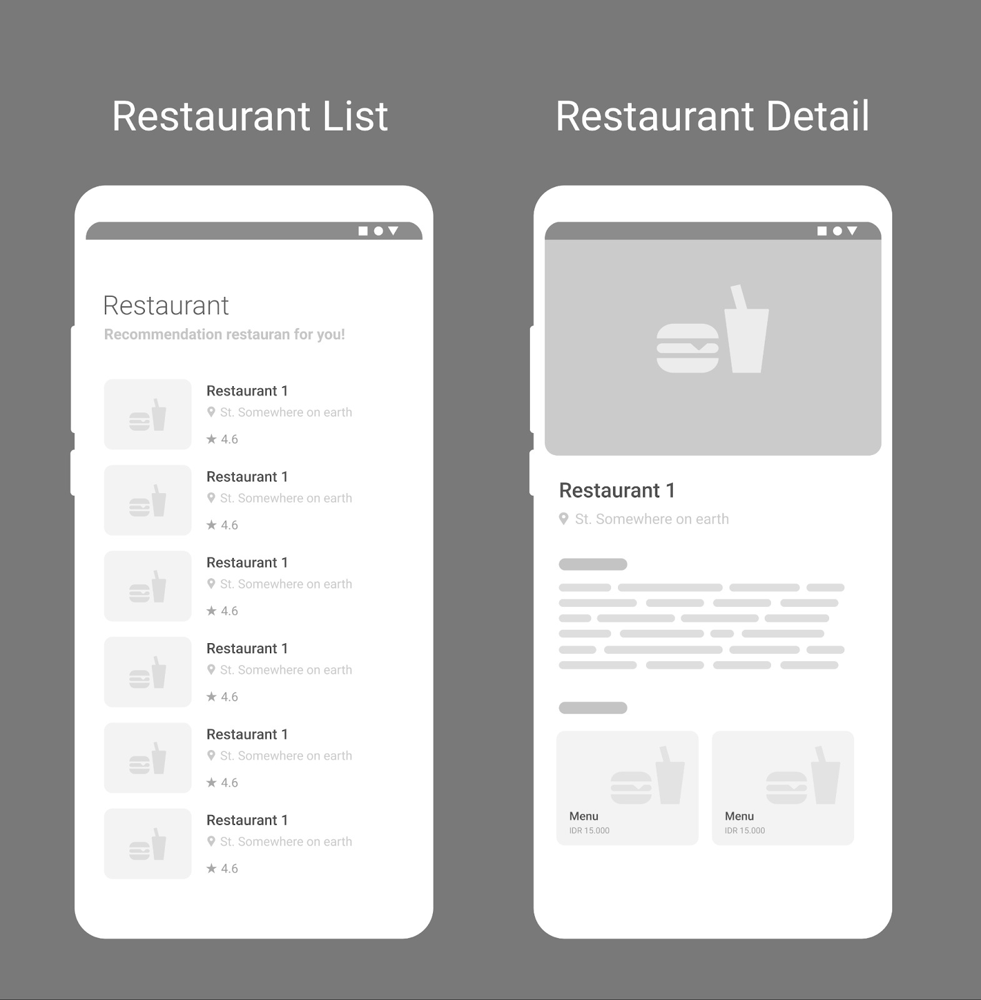

# Proyek: Restaurant App dengan API

## Tujuan

Proyek ini memerlukan pembuatan aplikasi bertema Restaurant App. Fokus pada pembuatan aplikasi terbaik dengan pendekatan kreatif dan inovatif, sambil memenuhi semua kriteria yang ditentukan. Aplikasi harus berpusat pada pengguna, dengan tampilan minimalis dan desain terkini. Hindari elemen desain yang tidak perlu, seperti gradient berlebihan atau pola AI-generated yang tidak jelas (AI slop). Prioritaskan user-centered design: antarmuka sederhana, navigasi intuitif, dan elemen visual yang fungsional.

Aplikasi ini dibangun berdasarkan materi yang telah diselesaikan, termasuk:
- Fundamental Flutter
- Desain UI dengan Widget
- State Management
- Networking

## Kriteria Wajib

Semua kriteria berikut harus dipenuhi untuk memastikan aplikasi user-friendly. Gunakan best practices Flutter, seperti menghindari overflow dengan widget seperti Expanded, Flexible, atau Flex, serta memastikan responsivitas di berbagai perangkat (iOS dan Android).

1. **Halaman Daftar Restoran**
   - Buat satu halaman yang menampilkan daftar restoran.
   - Data daftar restoran diambil dari API.
   - Setiap item daftar minimal mencakup: nama, gambar, kota, dan rating restoran.
   - Gunakan layout list yang scrollable, seperti ListView.builder untuk efisiensi.
   - Integrasikan animasi Hero untuk transisi ke halaman detail (lihat kriteria tambahan).

2. **Halaman Detail Restoran**
   - Buat satu halaman yang menampilkan detail restoran.
   - Data detail diambil dari API.
   - Tampilkan informasi lengkap: nama, gambar, deskripsi, kota, alamat, rating, menu makanan, dan menu minuman.
   - Pastikan semua informasi terlihat jelas: Bungkus menu makanan/minuman dalam Card individual, lalu iterasikan menggunakan ListView atau SingleChildScrollView + Row/Column untuk tampilan horizontal/vertikal yang rapi.
   - Untuk deskripsi panjang, gunakan Text dengan maxLines dan overflow: TextOverflow.ellipsis untuk menghindari overflow teks.
   - Tambahkan daftar review restoran dari API, dan fitur untuk menambahkan review baru (lihat kriteria tambahan).

3. **Penggantian Tema Default**
   - Tambahkan dukungan tema terang (light) dan gelap (dark), dengan toggle otomatis berdasarkan sistem atau manual.
   - Ubah font default ke font modern dan readable, seperti Google Fonts (misalnya, Roboto atau Inter).
   - Sesuaikan warna tema utama (primary, accent) selain warna default Flutter, dengan palet minimalis (misalnya, netral tones untuk background, aksen sederhana tanpa gradient berlebih).

4. **Indikator Loading**
   - Tambahkan indikator loading untuk setiap panggilan API (misalnya, saat fetch daftar atau detail).
   - Indikator bisa berupa CircularProgressIndicator, gambar statis, atau animasi (seperti Lottie/Rive untuk sentuhan modern, tapi tetap minimalis).
   - Pastikan indikator terpusat dan tidak mengganggu UI.

5. **State Management**
   - Gunakan library Provider untuk mengelola state secara global.
   - Cukup satu state management; hindari campuran library.
   - Manfaatkan sealed class (atau union types di Dart) untuk menangani state API, seperti: Loading, Success<Data>, Error<Message>. Ini memudahkan penanganan asynchronous operations dan meningkatkan readability kode.

## Kriteria Tambahan dan Penilaian

Fitur-fitur ini menambah nilai dan harus diimplementasikan untuk outcome optimal. Penilaian fokus pada kualitas kode dan user experience.

1. **Menuliskan Kode dengan Bersih**
   - Hapus komentar, kode tidak terpakai, dan import unused.
   - Gunakan indentasi konsisten (2-4 spasi) dan format kode dengan `flutter format`.
   - Struktur folder: lib/src/features untuk modularitas (misalnya, features/restaurant_list, models, services).

2. **Menampilkan Pesan Error**
   - Saat gagal memuat data (misalnya, no internet atau API error), tampilkan pesan error.
   - Pesan bisa berupa teks sederhana, gambar ikon, atau animasi minimalis.
   - Buat pesan mudah dipahami, seperti "Gagal memuat data. Periksa koneksi internet Anda." dengan tombol retry.

3. **Menambahkan Animasi Hero**
   - Hubungkan animasi Hero antara halaman daftar dan detail.
   - Terapkan pada elemen seperti gambar atau nama restoran.
   - Animasi berjalan dua arah (asal ke tujuan dan sebaliknya) untuk transisi mulus.

4. **Menambahkan Fitur Pencarian Restoran**
   - Buat halaman khusus untuk pencarian.
   - Sertakan TextField untuk input query, dan ListView untuk hasil.
   - Gunakan endpoint pencarian API (contoh: https://restaurant-api.dicoding.dev/search?q=cafe).
   - Debounce input untuk menghindari panggilan API berlebih (best practice: gunakan Timer atau package seperti rx_dart).

5. **Menambahkan Fitur Review Restoran**
   - Di halaman detail, tampilkan daftar review dari API.
   - Tambahkan form untuk submit review: field nama dan ulasan.
   - Kirim review via POST ke API, sertakan id restoran.

## Referensi Tampilan

Gunakan kerangka tampilan berikut sebagai referensi (berdasarkan wireframes yang disediakan):

- **Halaman Daftar Restoran**: List vertikal dengan card sederhana untuk setiap restoran. Setiap card mencakup ikon/gambar kecil, nama, lokasi (kota), dan rating bintang. Judul halaman: "Restaurant Recommendation for You".
- **Halaman Detail Restoran**: Header dengan gambar besar, diikuti nama, lokasi, rating, deskripsi, dan section menu (makanan/minuman dalam grid atau list card). Tambahkan section review di bawahnya.

Pastikan desain minimalis: Gunakan whitespace yang baik, font clean, dan warna netral. Hindari overflow dengan wrapping widget dalam ScrollView jika diperlukan.

## Resources

Gunakan Dicoding Restaurant API untuk semua data. Dokumentasi lengkap tersedia di laman utama API.

- **Base URL**: https://restaurant-api.dicoding.dev

### Endpoint

1. **Get List of Restaurant**
   - URL: /list
   - Method: GET
   - Response Example:
     ```json
     {
       "error": false,
       "message": "success",
       "count": 20,
       "restaurants": [
         {
           "id": "rqdv5juczeskfw1e867",
           "name": "Melting Pot",
           "description": "Lorem ipsum dolor sit amet, consectetuer adipiscing elit. Aenean commodo ligula eget dolor. ...",
           "pictureId": "14",
           "city": "Medan",
           "rating": 4.2
         },
         {
           "id": "s1knt6za9kkfw1e867",
           "name": "Kafe Kita",
           "description": "Quisque rutrum. Aenean imperdiet. Etiam ultricies nisi vel augue. Curabitur ullamcorper ultricies nisi. ...",
           "pictureId": "25",
           "city": "Gorontalo",
           "rating": 4
         }
       ]
     }
     ```

2. **Get Detail of Restaurant**
   - URL: /detail/:id
   - Method: GET
   - Response Example:
     ```json
     {
       "error": false,
       "message": "success",
       "restaurant": {
         "id": "rqdv5juczeskfw1e867",
         "name": "Melting Pot",
         "description": "Lorem ipsum dolor sit amet, consectetuer adipiscing elit. Aenean commodo ligula eget dolor. Aenean massa. ...",
         "city": "Medan",
         "address": "Jln. Pandeglang no 19",
         "pictureId": "14",
         "categories": [
           { "name": "Italia" },
           { "name": "Modern" }
         ],
         "menus": {
           "foods": [
             { "name": "Paket rosemary" },
             { "name": "Toastie salmon" }
           ],
           "drinks": [
             { "name": "Es krim" },
             { "name": "Sirup" }
           ]
         },
         "rating": 4.2,
         "customerReviews": [
           {
             "name": "Ahmad",
             "review": "Tidak rekomendasi untuk pelajar!",
             "date": "13 November 2019"
           }
         ]
       }
     }
     ```

3. **Search Restaurant**
   - URL: /search?q=<query>
   - Method: GET
   - Response Example:
     ```json
     {
       "error": false,
       "founded": 1,
       "restaurants": [
         {
           "id": "fnfn8mytkpmkfw1e867",
           "name": "Makan mudah",
           "description": "But I must explain to you how all this mistaken idea of denouncing pleasure and praising pain was born and I will give you a complete account of the system, ...",
           "pictureId": "22",
           "city": "Medan",
           "rating": 3.7
         }
       ]
     }
     ```

4. **Add Review**
   - URL: /review
   - Method: POST
   - Headers: Content-Type: application/json
   - Body: JSON {"id": string, "name": string, "review": string}
   - Response Example:
     ```json
     {
       "error": false,
       "message": "success",
       "customerReviews": [
         {
           "name": "Ahmad",
           "review": "Tidak rekomendasi untuk pelajar!",
           "date": "13 November 2019"
         },
         {
           "name": "test",
           "review": "makanannya lezat",
           "date": "29 Oktober 2020"
         }
       ]
     }
     ```

### Restaurant Image
- Small: https://restaurant-api.dicoding.dev/images/small/<pictureId>
- Medium: https://restaurant-api.dicoding.dev/images/medium/<pictureId>
- Large: https://restaurant-api.dicoding.dev/images/large/<pictureId>

## Catatan Penting
- **Hindari Overflow**: Selalu gunakan Expanded/Flexible/Flex sebagai parent untuk widget yang bisa expand, agar tampilan tetap dalam batas layar.
- **Tampilkan Seluruh Informasi**: Jangan potong informasi di halaman detail. Gunakan scrollable widgets untuk konten panjang.
- **Best Practices Tambahan**: Integrasikan package seperti http atau dio untuk networking, cached_network_image untuk gambar (hindari loading ulang), dan provider untuk state. Uji di emulator iOS/Android untuk cross-platform compatibility. Fokus pada accessibility: gunakan Semantics untuk screen reader, dan kontras warna tinggi untuk tema dark/light.